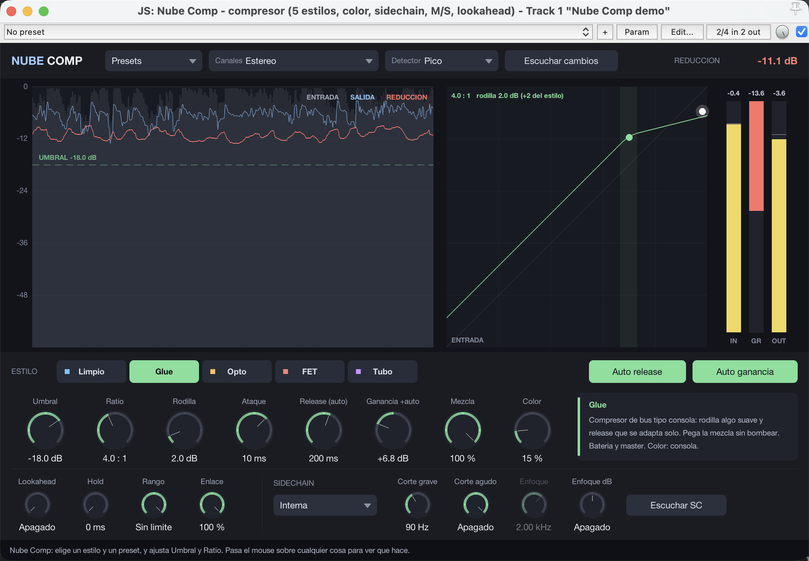

<!-- en -->
# Nube Comp

A free compressor for [REAPER](https://www.reaper.fm), written as a JSFX (macOS / Windows / Linux), part of the
[Nube plugins](https://github.com/KevinMeneses/nube-plugins).



5 styles (Clean, Glue, Opto, FET, Tube) with per-style saturation, ratio up to ∞, knee, auto release, hold, range, parallel mix, peak/RMS detection, stereo / M-S / mid-only / side-only, filtered external sidechain, lookahead with latency compensation, graphs and 12 presets. ~1 % CPU.

**Install** — with [ReaPack](https://reapack.com): *Extensions → ReaPack → Import repositories*, paste
`https://github.com/KevinMeneses/nube-plugins/raw/main/index.xml`, then install **Nube Comp**. Or copy `nube_comp.jsfx`
into `REAPER/Effects/Nube Comp/` (on macOS `./install.sh` links it). It shows up as **JS: Nube Comp**. The interface is in Spanish.

**How it was made** — designed and built with [Claude Code](https://claude.com/claude-code). Since an AI can't
listen, every feature is verified by rendering test cases inside REAPER and comparing them with the theory
(`tests/run.sh`), plus mouse-driven UI tests (`tests/ui_test.py`).

**License** — GPL-3.0-or-later (see `LICENSE`).

---

## Español
Compresor para REAPER (JSFX, macOS/Windows/Linux), hermano de [Nube EQ](https://github.com/KevinMeneses/nube-eq): fácil de usar, con todo lo de
un compresor de pago y cinco "colores" de sonido.


- **5 estilos** con carácter propio:
  - **Limpio**: VCA transparente, hace exactamente lo que marcan los controles.
  - **Glue**: compresor de bus tipo consola. Rodilla algo más suave y release que se adapta solo.
  - **Opto**: celda óptica (estilo LA-2A). Ataque suave y release que se alarga mientras más rato comprime.
  - **FET**: rápido y agresivo (estilo 1176). Deja pasar el golpe y recupera rápido cuando aprieta fuerte.
  - **Tubo**: Vari-Mu. Rodilla muy ancha (comprime más mientras más fuerte entra), suave y gordo.
- **Color**: saturación analógica de cada estilo (pares = tibio en Opto/Tubo, impares = filo en FET), 0 % = limpio.
- Umbral, ratio hasta **∞:1**, rodilla, ataque (0.01–300 ms), release (5 ms–3 s), **auto release**, hold y **rango**
  (máximo de reducción).
- **Ganancia** + **auto ganancia**, y **mezcla** para compresión paralela (NY).
- **Detector** de pico o RMS. **Enlace estéreo** 0–100 %.
- **Canales**: estéreo, **Mid/Side**, o comprimir solo el centro o solo los lados.
- **Sidechain** interno o externo (canales 3/4) con **corte grave**, **corte agudo** y **enfoque** (sube o baja una
  zona solo en el detector, por ejemplo +6 dB en 6 kHz para reaccionar a las eses). **Escuchar SC** para ajustarlo.
- **Lookahead** hasta 10 ms (REAPER compensa la latencia).
- **Escuchar cambios**: suena solo lo que el compresor quita.
- Gráfica en vivo (entrada, salida y reducción), **curva de transferencia** con el nivel actual, medidores IN/GR/OUT.
- Ayuda en el pie de la ventana de todo lo que tienes bajo el mouse; cada estilo trae su explicación.
- CPU: ~1 % de un núcleo por instancia con todo encendido.

## Instalar

```sh
./install.sh
```

Crea un enlace en `~/Library/Application Support/REAPER/Effects/Nube Comp/`. En REAPER aparece como
**JS: Nube Comp** en el navegador de FX. Si cambias el código, vuelve a insertar el FX.

## Cómo se usa

| Acción | Cómo |
|---|---|
| Umbral | Perilla, o **arrastra arriba/abajo en la gráfica** (la línea punteada es el umbral) |
| Ratio | Perilla, o **rueda del mouse sobre la gráfica** |
| En la curva | Arrastra **izquierda/derecha = umbral**, **arriba/abajo = ratio**, rueda = rodilla |
| Perillas | Arrastra arriba/abajo o usa la rueda; **Shift** = fino; **doble clic** = valor por defecto |
| Presets | Botón *Presets* o clic derecho en la gráfica |
| Reiniciar máximos | Clic en los medidores |

### Sidechain (kick que baja el 808)

1. En la pista del 808 pon Nube Comp y elige el preset *Sidechain kick a 808 (3/4)*.
2. En la pista del kick, crea un envío hacia el 808 en los canales **3/4** (la pista del 808 necesita 4 canales;
   si no, el pie de la ventana avisa).

## Presets

| Preset | Qué hace |
|---|---|
| Voz Tonor - Comp (Nube baja) | El "Voz · Comp" de la cadena *Voz Tonor 1*: −20 dB, 3.5:1, rodilla 4, 5/79 ms, SC corte 99 Hz, +5.9 dB |
| Voz Tonor - Nivelador (Nube baja) | El "Voz · Nivelador": −17.7 dB, 3:1, rodilla 6, 15/150 ms, RMS, +6 dB |
| Voz rap al frente (FET) | −22 dB, 4:1, 3/60 ms, color 30 %, SC corte 100 Hz, auto ganancia |
| Voz suave y pareja (Opto) | −24 dB, 3:1, 10/250 ms, color 20 % |
| 808 / bajo parejo | −18 dB, 4:1, ataque 25 ms (deja pasar el golpe), 150 ms |
| Batería pegada (Glue) | −18 dB, 4:1, 10 ms, auto release, SC corte 90 Hz, color 15 % |
| Batería paralela (NY) | FET −30 dB, 10:1, 1/80 ms, color 40 %, mezcla 35 % |
| Sidechain kick a 808 (3/4) | Externo, −24 dB, 6:1, 1/60 ms, hold 10 ms |
| Master glue suave | Glue −14 dB, 2:1, rodilla 8, 30 ms, auto release, SC corte 60 Hz |
| Control de picos (casi limitador) | −6 dB, ∞:1, 0.1/60 ms, lookahead 2 ms |
| Tubo cálido (Rhodes / pads / coros) | Tubo −24 dB, 2.5:1, 20/300 ms, color 45 % |

## Estructura

- `nube_comp.jsfx`: el plugin (DSP + interfaz).
- `tests/run.sh`: renderiza 49 casos en una pestaña temporal de REAPER y los compara con la teoría (56 chequeos, más que ningún render tenga NaN ni quede desalineado):
  curva estática (dura, rodilla, ∞:1, rango), ganancia y auto ganancia, mezcla, RMS, enlace, M/S, solo Mid/Side,
  sidechain externo, filtros y enfoque del SC, escuchar SC y cambios, tiempos de ataque/release/hold, lookahead
  (y que la latencia quede compensada), armónicos del color, los 5 estilos y los 12 presets.
- `tests/ui_demo.lua` / `tests/ui_close.lua`: abren y cierran una pestaña de demo con audio.
- `tests/ui.py` + `tests/ui_dump.lua` + `tests/scroll.swift`: pruebas de la interfaz con el mouse (`cliclick`).
- `tests/perf.lua`: CPU en el peor caso.

## Detalles técnicos

- Detector: pico con ataque instantáneo y caída corta (≤ 10 ms) en el dominio del nivel, o RMS de 10 ms
  normalizado a seno (un seno marca lo mismo en los dos modos).
- Reducción en dB con rodilla cuadrática; suavizado ataque/release en dB, con un hold interno corto (≤ 10 ms, 10 % del
  release) para que el release no actúe entre los picos de una misma onda: la compresión sostenida coincide con la curva.
- Estilos: rodilla extra (Glue +2, Opto +6, Tubo +12), segundo polo en la reducción (Opto/FET/Tubo: ataque en "S"),
  release por estilo (Opto con memoria de carga, FET más rápido con mucha reducción, Tubo más lento) y auto release
  parcial en Glue.
- Color: drive → recorte suave `u/√(1+k·u²)` (impares) → `e·u²` sin DC (pares) → /drive. Ganancia 1 en señal chica.
  Sin sobremuestreo: es un polinomio/racional suave, los armónicos caen rápido.
- Trampas de EEL2 (las mismas del EQ): variables sin distinción de mayúsculas, nada de notación científica, y la
  interfaz corre en otro hilo: no comparte funciones con locales ni variables con el audio (la interfaz pide
  recalcular con `upd = 1` y el audio lo hace en `@block`).

Nota sobre las pruebas: necesitan REAPER y Python con numpy, scipy y soundfile (`NUBE_PY=/ruta/a/python tests/run.sh`). Los casos con voz o música real usan grabaciones propias que no están en el repo (`tests/signals/`); sin ellas esos casos no se pueden correr.
